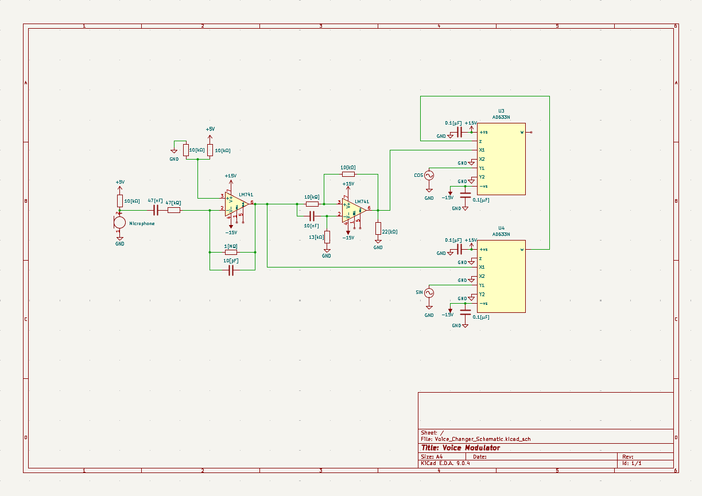

# Analog Voice Frequency Shifter

**Analog Signal Processing | Circuit Design | Frequency Mixing | Hardware Implementation | Experimental Testing**

## Project Overview

This project involved designing, building, and testing a fully analog voice frequency-shifting circuit using operational amplifiers and analog multiplier ICs.

The goal was to explore analog signal processing techniques by developing a circuit capable of translating an audio signal's frequency components to change its perceived pitch.

The circuit uses **LM741/UA741 operational amplifiers** for amplification and signal conditioning, along with **AD633 analog multipliers** for frequency conversion. Sine and cosine reference signals are used to support the frequency-shifting process.

The project was developed through circuit design, simulation, breadboard implementation, troubleshooting, and experimental testing. The completed prototype was successfully demonstrated using an audio input.

### Project Highlights

- Designed and constructed an analog frequency-shifting circuit.
- Implemented frequency mixing using AD633 analog multiplier ICs.
- Generated quadrature sine and cosine reference signals.
- Used op-amp stages for signal amplification and conditioning.
- Modified the circuit during testing to improve the desired output.
- Measured voltage gain, signal-to-noise ratio, frequency conversion, and power consumption.
- Demonstrated the working hardware prototype.

---

## 1. Project Images

### Circuit Schematic

  

**Figure 1.** Original circuit schematic showing the operational amplifiers, AD633 multiplier stages, passive components, and signal connections.

*Note: The schematic represents the initial design. Some op-amp configurations were modified during breadboard testing to improve circuit operation.*

### Physical Circuit Implementation

  

**Figure 2.** Breadboard implementation of the analog frequency-shifting circuit.

### Hardware Testing and Demonstration

  

**Figure 3.** Hardware setup used during testing and demonstration.

---

## 2. Project Objectives

The primary objectives were to:

- Design a working analog circuit capable of shifting audio-frequency signals.
- Understand the operating principles of analog multipliers and frequency mixing.
- Apply operational amplifier theory to signal amplification and conditioning.
- Investigate the use of sine and cosine reference signals in frequency translation.
- Construct and troubleshoot the circuit on a breadboard.
- Evaluate the prototype using electrical measurements.
- Compare measured performance against the intended design requirements.

---

## 3. Theory of Operation

### Frequency Translation Through Analog Multiplication

Frequency shifting can be accomplished by multiplying an input signal by a sinusoidal reference signal.

Consider an input:

$$
v_{in}(t)=A\cos(2\pi f_{in}t)
$$

and a reference:

$$
v_{ref}(t)=B\cos(2\pi f_ct)
$$

Multiplying these signals gives:

$$
v_{out}(t)=AB\cos(2\pi f_{in}t)\cos(2\pi f_ct)
$$

Using the trigonometric identity:

$$
\cos(A)\cos(B)=\frac{1}{2}[\cos(A+B)+\cos(A-B)]
$$

the output becomes:

$$
v_{out}(t)=\frac{AB}{2}
\left[
\cos(2\pi(f_{in}+f_c)t)
+
\cos(2\pi(f_{in}-f_c)t)
\right]
$$

This produces two frequency components:

- **Sum frequency:** $f_{in}+f_c$
- **Difference frequency:** $|f_{in}-f_c|$

By controlling the reference frequency and the output signal combination, the circuit can produce frequency-shifted audio.

### Quadrature Reference Signals

The circuit uses sine and cosine reference signals separated by 90 degrees.

These signals are generated using two synchronized waveform-generator channels.

The quadrature signals provide the phase relationships needed for the multiplier stages and can be used in frequency-shifting architectures that emphasize one translated frequency component.

In this project, adjustments to the op-amp configuration were used to improve the desired frequency-shifted output during hardware testing.

---

## 4. Circuit Design

The circuit consists of several functional stages.

### Stage 1: Microphone Input and Preamplification

The microphone produces a relatively small electrical signal corresponding to the input audio.

An LM741/UA741 operational amplifier is used to amplify the signal before frequency conversion.

The original design incorporates:

- Microphone input
- AC-coupling capacitor
- Operational amplifier
- Feedback resistor network

The coupling capacitor helps block DC components while allowing the audio-frequency signal to pass.

### Stage 2: Signal Conditioning

Additional op-amp and passive-component stages condition the signal before it enters the analog multipliers.

The circuit uses resistor and capacitor networks to establish gain, coupling, and frequency-dependent behavior.

Components in the original schematic include:

- 47 nF coupling capacitor
- 10 nF capacitors
- 0.1 µF capacitors
- 10 pF capacitor
- Resistors used for gain and biasing

The signal-conditioning stages prepare the audio input for the frequency-conversion process.

### Stage 3: Sine and Cosine Reference Generation

Two waveform-generator channels provide the reference signals required by the multiplier stages.

The signals are configured as follows:

- Channel 1: Sine wave
- Channel 2: Sine wave shifted by 90 degrees to create a cosine reference
- Both channels: Equal frequency

The reference frequency can be adjusted to control the amount of frequency translation.

During testing, a reference frequency of 200 Hz was used for several measurements.

### Stage 4: AD633 Analog Multiplication

The AD633 is a four-quadrant analog multiplier capable of multiplying two input signals.

Its ideal transfer function is:

$$
W=\frac{(X_1-X_2)(Y_1-Y_2)}{10}+Z
$$

where the signals are expressed in volts.

The circuit uses two AD633 multiplier ICs to process the conditioned audio signal with the quadrature references.

This produces translated frequency components that can be combined and conditioned by the remaining circuitry.

### Stage 5: Output Signal Conditioning

The output stages use operational amplifiers and passive components to produce the final audio-frequency signal.

During physical testing, the operational amplifier configuration was modified to improve the desired frequency-shifted response.

These changes were important in achieving a working prototype.

---

## 5. Hardware Implementation

The circuit was physically constructed on a breadboard using discrete passive components and integrated circuits.

### Major Components

| Component | Purpose |
|---|---|
| LM741 / UA741 op-amps | Signal amplification and conditioning |
| AD633 analog multipliers (2) | Frequency translation |
| Microphone | Audio input |
| Resistors | Gain setting and biasing |
| Capacitors | AC coupling and signal conditioning |
| Function generator | Sine and cosine reference generation |
| Oscilloscope | Waveform observation and measurement |
| Multimeter | Voltage and current measurements |
| DC power supplies | Circuit power |

The analog circuitry was operated using positive and negative 15 V supplies, with a separate approximately 5 V supply for the microphone circuitry.

### Implementation Challenges

Moving from the original circuit design to a working breadboard prototype required several adjustments.

The primary challenges involved:

- Configuring the operational amplifier stages
- Establishing usable input and output signal levels
- Producing synchronized quadrature reference signals
- Controlling unwanted frequency components
- Troubleshooting noise and signal distortion
- Verifying circuit behavior with laboratory instruments

The final prototype incorporated modifications to the original op-amp configuration to improve the frequency-shifted output.

---

## 6. Experimental Measurements and Results

After construction, the circuit was evaluated using a waveform generator, oscilloscope, multimeter, and microphone.

The following measurements were recorded during testing.

### Performance Summary

| Parameter | Measured Result |
|---|---:|
| Voltage gain | 19.4 V/V |
| Signal-to-noise ratio | 43.17 dB |
| Total power consumption | 0.334 W |
| Observed microphone frequency range | 250–1250 Hz |
| Frequency conversion test | 200 Hz input → 401.2 Hz output |

These values represent measurements under specific test conditions, rather than a complete characterization across all frequencies and operating conditions.

### 6.1 Frequency Conversion

To evaluate the frequency-conversion behavior, a 200 Hz sine wave was applied to the circuit input.

The sine and cosine reference signals were also set to 200 Hz.

| Input Frequency | Measured Output Frequency |
|---|---|
| 200 Hz | 401.2 Hz |

The output was measured using an oscilloscope.

The result is close to the expected sum-frequency component:

$$
f_{sum}=200+200=400\text{ Hz}
$$

The measured frequency of **401.2 Hz** demonstrates frequency translation under this test configuration.

This measurement verifies one operating condition; additional measurements would be needed to characterize the complete adjustable frequency-shifting range.

### 6.2 Voltage Gain

The circuit's voltage gain was measured using a 100 mV peak-to-peak input signal.

| Input Voltage | Output Voltage | Gain |
|---|---|---|
| 0.100 Vpp | 1.94 Vpp | 19.4 V/V |

Voltage gain was calculated using:

$$
A_v=\frac{V_{out}}{V_{in}}
$$

Therefore:

$$
A_v=\frac{1.94}{0.100}=19.4
$$

**Measured voltage gain: 19.4 V/V**

This measurement demonstrated the amplification achieved through the circuit under the test conditions.

### 6.3 Input Audio Frequency Range

The frequency range of the microphone signal was investigated by speaking into the microphone at different pitches.

The observed frequency range was approximately:

**250–1250 Hz**

This represents the frequency readings obtained during the test rather than the complete frequency response or bandwidth of the circuit.

### 6.4 Power Consumption

Circuit power consumption was estimated from the measured supply voltages and currents.

| Supply | Measured Voltage | Measured Current | Power |
|---|---:|---:|---:|
| +5 V | 4.98 V | 0.52 mA | 0.0026 W |
| +15 V | 15.12 V | 10.98 mA | 0.166 W |
| -15 V | -14.96 V | -11.05 mA | 0.165 W |

The total power was calculated by summing the power delivered by the supplies:

$$
P_{total}=0.0026+0.166+0.165
$$

$$
P_{total}\approx0.334\text{ W}
$$

**Total measured power consumption: approximately 0.334 W**

This was below the project's 5 W power-consumption target.

### 6.5 Signal-to-Noise Ratio

The signal-to-noise ratio was estimated by comparing the output signal voltage with the measured noise voltage.

The recorded measurements were:

| Measurement | Value |
|---|---:|
| Output signal | 10.08 Vpp |
| Output noise | 0.07 Vpp |
| Calculated SNR | 43.17 dB |

The amplitude-ratio calculation was:

$$
SNR=20\log_{10}\left(\frac{V_{signal}}{V_{noise}}\right)
$$

Substituting the measurements:

$$
SNR=20\log_{10}\left(\frac{10.08}{0.07}\right)
$$

$$
SNR\approx43.17\text{ dB}
$$

**Estimated SNR: 43.17 dB**

This met the project's target of greater than 40 dB under the measurement conditions.

The calculation uses measured peak-to-peak amplitudes. A more comprehensive noise characterization would require RMS measurements over a defined bandwidth.

---

## 7. Results and Engineering Analysis

The project successfully demonstrated the implementation of an analog audio frequency-shifting circuit using operational amplifiers and analog multipliers.

### Key Results

- **Frequency translation:** A 200 Hz input produced a measured output component at 401.2 Hz with 200 Hz reference signals.
- **Amplification:** A voltage gain of 19.4 V/V was measured.
- **Noise performance:** An amplitude-based SNR estimate of 43.17 dB was obtained.
- **Power consumption:** The prototype consumed approximately 0.334 W under the tested conditions.
- **Hardware validation:** The completed breadboard circuit was demonstrated using an audio input.

### Engineering Lessons

One of the most valuable aspects of this project was the difference between the original circuit design and the behavior of the physical implementation.

Although the analog multiplication theory provides a clear prediction of sum and difference frequency generation, obtaining a useful output from a physical circuit required troubleshooting the amplifier stages and examining the resulting signals.

The project strengthened my understanding of how mathematical signal-processing concepts translate into real analog hardware.

---

## 8. Engineering Skills Demonstrated

| Skill | Application |
|---|---|
| Analog Circuit Design | Op-amp amplification, coupling, and signal conditioning |
| Signal Processing | Frequency mixing and spectral translation |
| Analog Multipliers | AD633-based frequency conversion |
| Operational Amplifiers | LM741/UA741 configuration and troubleshooting |
| Circuit Prototyping | Breadboard construction and modification |
| Oscilloscope Measurements | Frequency and peak-to-peak voltage measurements |
| Electrical Testing | Gain, power, and noise evaluation |
| Technical Analysis | Comparison of theoretical and measured behavior |
| Troubleshooting | Adjusting the circuit to obtain the desired response |

---

## 9. Limitations and Future Improvements

The prototype successfully demonstrated frequency-conversion behavior, but several areas could be improved in future versions.

1. **Expanded Frequency Testing**
   - Measure output frequency over a wider range of input and reference frequencies.
   - Compare measured results with theoretical sum and difference frequencies.

2. **Frequency-Domain Characterization**
   - Use FFT or spectrum-analyzer measurements to identify the translated frequency components.
   - Quantify unwanted mixing products and output distortion.

3. **Noise and Distortion Analysis**
   - Characterize noise using RMS measurements over a defined bandwidth.
   - Investigate the effects of amplifier configuration and component selection.

4. **Circuit Documentation**
   - Update the schematic to reflect the final breadboard modifications.
   - Compare the revised circuit with the original design.

5. **PCB Implementation**
   - Convert the tested breadboard circuit into a PCB design.
   - Investigate grounding, signal routing, and noise reduction.

---

## 10. Tools and Technologies

- Analog Circuit Design
- LM741 / UA741 Operational Amplifiers
- AD633 Analog Multipliers
- Circuit Prototyping
- Oscilloscope and Waveform Generator
- Digital Multimeter
- Frequency Mixing
- Audio Signal Processing
- Electronic Testing and Troubleshooting

---

## Author

**Josiah Germain**  
Electrical Engineering — University of Houston

[GitHub Profile](https://github.com/jgermain)
